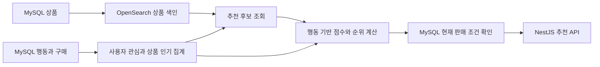

# 상품 추천시스템 실습 계획

작성일: 2026-11-02 / 최종 갱신: 2026-11-21

목표는 **DB 데이터를 OpenSearch에 색인하고, 색인에서 찾은 후보를 행동/구매 이력으로 정렬해 추천 API를 가동하는 것**입니다.
사용자가 확정한 상품 도메인, 합성 데이터와 본 실습 규모를 유지합니다. 아래 후보 수와 점수 정책은 첫 구현을 위한 제안입니다.
현재 완료한 범위는 기존 데이터/실행 환경 확인(0단계), 상품 1만 개 색인(1단계)과 사용자 이력 집계/추천 후보 조회(2단계)입니다.
순위 계산과 추천 API부터는 미구현입니다.

## 기준 흐름과 첫 완료 형태

첫 결과는 검색어 없이 합성 사용자 한 명에게 아직 구매하지 않은 **Product 상위 10개**를 반환하는 로컬 API입니다.
상품명 검색과 개인화 추천은 입력과 점수 목적이 다르므로 `searchProducts`를 추천 API로 간주하지 않습니다.
사용자 이력이 달라지면 후보나 순위가 달라지고, 이력이 없으면 인기 상품을 추천해야 합니다.

OpenSearch는 상품 후보를 찾는 역할을 맡습니다. 사용자 관심과 추천 점수는 별도로 계산합니다.
색인 성공만으로 추천이 가동됐다고 처리하지 않으며, 마지막 API 응답까지 연결해야 첫 구현이 완료됩니다.

## 현재 준비 상태

| 구분 | 확인된 상태 | 다음 작업 |
|---|---|---|
| 합성 데이터 | 사용자 100,000명, 상품/SKU 각각 10,000개, 행동 10,000,040건 | 기존 데이터 재사용 |
| 거래 데이터 | 주문 347,720건, 구매 280,267건과 성공 매입 연결 | 구매 이력과 인기 집계에 연결 |
| DB 검증 | `demo_nest_recommender` 적재 완료, 거래 일관성 검사 19개 통과 | 실행 전 대상 DB 확인 |
| 검색 색인 | 전용 Alias `rec-catalog-products-read/write`에 10,000건 색인, reconciliation 차이 0 | [색인 기록](search-index.md) 재사용 |
| 추천 후보 | 프로필 version `demo-20260401` 활성(검증 8종 통과), 내부 후보 조회와 CLI로 최대 200개 확인 | [후보 기록](candidates.md)을 3단계에 연결 |
| 추천 기능 | 순위 계산, 판매 조건 확인과 추천 API 미구현 | 3~4단계 구현 |
| 추천 평가 | 시간 분할 규칙만 정의됨 | 5단계에서 실제 지표 측정 |

데이터 규모와 검증 수치는 2026-11-03 생성/적재 기록이며 DB 존재와 건수는 2026-11-04 재확인했습니다.
색인, 검색, 이력 집계와 후보 조회 검증은 2026-11-08 기록입니다. 이후 OpenSearch 프로세스 가동 여부는 실행 전에 다시 확인합니다.
[기본 SQL 안내](local-sql.md), [거래 데이터 안내](commerce-data.md), [생성 명세](synthetic-data-spec.md)를 정본으로 사용합니다.

## 데이터의 역할과 경계

- MySQL의 `products`, `items`, 분류와 태그를 기존 Projector로 변환해 OpenSearch에 상품 문서를 만듭니다.
  행동 1,000만 건이나 결제 거래를 상품 문서에 붙이지 않습니다. 원본 거래를 별도로 색인하는 기능은 첫 범위에 없습니다.
- `rec_events`에서 cutoff 이전의 조회/장바구니/구매를 집계합니다. 구매는 `rec_purchase_orders`와 성공한
  `CAPTURE` 거래로 대조합니다. 사용자 프로필과 상품 인기는 버전, 프로필 cutoff와 인기 cutoff를 가진 배치 산출물로 저장합니다.
- 초기에는 이 집계를 추천 서비스에서 읽습니다. 인기 필드를 strict 상품 Mapping에 임의로 추가하지 않습니다.
  2단계에서 집계를 버전별 MySQL 테이블로 저장하고 요청마다 사용자 키로 읽도록 정했습니다([후보 기록](candidates.md)).
- `rec_users.user_id`와 합성 고객 Member ID가 같고, `rec_products.product_id`와 Product/Item ID가 같습니다.
  `productKey`는 Product slug입니다. ID는 API에서 문자열로 다루고 후보/결과는 Product 단위로 중복 제거합니다.
- 현재 검색 문서에는 재고 수량이 없습니다. 최종 노출의 가격, 판매 상태와 재고는 MySQL에서 일괄 확인합니다.
  결제 금액과 주문 가능 여부의 최종 판정은 기존 주문 transaction이 담당합니다.
- 숨은 취향, 생성기 인기 순위와 미래 구매/환불은 입력에서 제외합니다. 조회 기록은 상세 조회이며 목록 노출이 아닙니다.
  합성 회원의 연락처, 결제 식별자를 추천 응답에 노출하지 않습니다.

## 단계별 실행과 완료 기준

### 0. 기존 데이터와 실행 환경 확인

기본/거래 manifest, DB 완료 표시와 검증 SQL을 확인합니다. 데이터 생성은 이미 끝났으므로 기본 출발점으로 재사용합니다.
앱의 기존 `.env`를 덮어쓰지 않고 실습 프로세스의 DB와 OpenSearch read/write Alias를 분리합니다.
SQL fixture는 앱 테이블을 직접 생성했으며 migration 이력이 없으므로 이 DB에 초기 migration이나 자동 schema update를 실행하지 않습니다.

완료 기준: 데이터 버전, seed, 대상 DB, OpenSearch 접속 가능 여부와 전용 Alias 이름을 기록하고 기존 앱 데이터를 건드리지 않습니다.

### 1. 상품 1만 개 색인과 검색 확인

[전체 rebuild](../../src/api/search/application/catalog-rebuild.service.ts)와 [기존 CLI](../../src/cli/search-rebuild.ts)를 재사용합니다.
[색인 실행 절차](search-index.md)를 따릅니다. Runbook의 migration 단계는 이 fixture DB에서 건너뜁니다.
처음에는 `--no-activate --evaluation-alias <전용_평가_Alias>`로 검사하고, 통과 후 전용 read/write Alias를 활성화합니다.
현재 fixture의 검색 Outbox는 비어 있으므로 drain만 실행해 최초 색인을 기대하지 않습니다.

완료 기준: MySQL 검색 대상 수와 OpenSearch root Count가 10,000으로 일치하고, 표본 상품의 ID/분류/태그/가격이 맞습니다.
상품명/카테고리 검색과 기존 GraphQL 검색을 확인하고, 전용 활성 Alias의 reconciliation 차이가 0건이어야 합니다.
`nested` Item의 내부 문서 수를 상품 수로 세지 않습니다. Bulk 오류나 검증 실패 시 Alias를 전환하지 않습니다.

### 2. 사용자 이력 집계와 OpenSearch 추천 후보 조회

먼저 cutoff 이전 사용자-상품별 이벤트 유형의 존재 여부에 조회 1, 장바구니 3, 구매 5를 합산합니다.
그 상품의 분류와 태그로 사용자 관심을 만들고, 상품별 고유 구매 사용자 수로 인기 순위를 만듭니다.
반복 조회는 무한 가산하지 않습니다. 비율과 가중치는 실제 선호 강도가 아닌 실습용 초기 설정입니다.

관심 분류/태그에 맞는 상품을 OpenSearch에서 조회합니다. 초기 예산은 관심 후보 최대 150개와 인기 후보 최대 50개입니다.
인기 후보도 OpenSearch에서 존재와 검색 노출 조건을 확인하며, 병합 후 이미 구매한 상품과 중복 Product를 제거합니다.
이력 없는 사용자는 인기 후보 최대 200개로 시작합니다. 후보 부족 시 다음 후보를 읽되 조회 횟수와 총 조회 수에 상한을 둡니다.
최종 목표는 최대 200개 후보입니다. 실제 후보 수, 출처, 중복/제외 수와 부족 여부를 기록합니다.

기존 상품 검색 API는 개인화 입력이나 추천 feature 반환 계약을 제공하지 않습니다. 기존 client/Mapping/Projector를 재사용하되
관심 조건, 구매 제외와 점수 계산용 상품 속성을 전달할 내부 추천 후보 조회 계약을 추가합니다.

완료 기준: 다른 관심을 가진 사용자와 이력 없는 사용자의 후보를 재현하고, 구매/중복 제외와 빈 결과를 테스트합니다.
후보가 실제 OpenSearch에서 왔음을 확인합니다. 집계 1,000만 행을 API 요청마다 스캔하지 않습니다.

### 3. 행동/구매 기반 순위 계산과 현재 판매 조건 확인

후보의 분류/태그와 사용자 관심의 일치도, 상품 인기를 이용한 설명 가능한 점수부터 만듭니다.
각 점수의 정규화와 결합 가중치를 명시하고 검증 기간에서 선택합니다. 동점은 `productKey` 오름차순으로 처리합니다.
OpenSearch 검색 점수를 그대로 개인화 점수라고 부르지 않습니다. 학습 모델 도입 전에도 이 경로를 실행할 수 있어야 합니다.

상위 후보를 MySQL에서 일괄 조회해 Product ACTIVE/미삭제, Item ALLOW/미삭제와 양수 재고를 확인합니다.
탈락하면 남은 후보에서 채우고 필요할 때 2단계의 한도 안에서 추가 조회합니다. 그래도 부족하면 10개 미만으로 반환합니다.
이미 구매한 상품을 다시 채우지 않으며, 노출 가능한 Item이 하나도 없는 Product는 반환하지 않습니다.

완료 기준: 손계산 fixture와 순위가 일치하고, 사용자 이력 변경에 따른 결과 차이와 인기 추천 fallback을 설명합니다.
중복, 품절, 삭제, 후보 부족과 동점을 검증합니다. 후보별 점수와 추천 사유를 로컬 진단 결과로 남깁니다.

### 4. NestJS 추천 API로 전체 흐름 가동

로컬 전용 GraphQL 추천 Query를 추가하고 Resolver, 추천 Service, 후보 조회와 순위 계산을 연결합니다.
합성 `userKey`와 반환 개수를 입력받되 최초 API는 인증된 관리자만 호출하고 production에서는 비활성화합니다.
반환은 상품 정보, 순위와 추천 사유로 제한합니다. 일반 회원 API 전환은 인증 주체와 사용자 ID 연결을 별도로 검증합니다.
현재 합성 회원에는 로그인용 비밀번호와 관리자 계정이 없습니다. 실습 DB에 충돌 없는 관리자 테스트 계정을 별도로 준비합니다.
상품까지 추가하는 기존 전체 Seeder를 그대로 실행해 상품 1만 개의 고정 fixture를 바꾸지 않습니다.

완료 기준: GraphQL 요청 한 번이 프로필 로딩, OpenSearch 조회, 순위 계산과 DB 판매 조건 확인을 거쳐 상위 10개를 반환합니다.
서로 다른 두 사용자와 이력 없는 사용자를 포함한 e2e를 수행합니다. 인기 fallback도 같은 검색/판매 조건을 통과해야 합니다.
이력이 없는 경우와 집계 파일 누락/버전 불일치를 구분합니다. 검색 장애나 데이터 오류는 명시적 이용 불가 오류로 처리합니다.

### 5. 후보 품질과 최종 추천 품질 평가

아래 시간/정답 계약을 적용한 평가기를 만듭니다. 인기 추천, 관심 기반 추천, 이후 협업 필터링을 같은 조건에서 비교합니다.
후보 생성은 Recall@200, 최종 결과는 Recall@10/NDCG@10을 보고합니다. 검색 후보에서 누락된 정답도 최종 평가 분모에 남깁니다.
전체 상품을 점수화한 참조 결과와 OpenSearch 후보를 사용한 결과를 비교해 후보 누락과 순위 오류를 구분합니다.

완료 기준: 개발 규모를 거쳐 본 규모 전체 평가 사용자의 결과, 신규/기존 및 활동량 구간별 지표를 기록합니다.
후보 수/부족률, 상품 노출 범위, API p50/p95와 오류율, 집계 시간/메모리도 측정합니다. 부하와 동시 요청 조건을 함께 남깁니다.
인기 기준보다 높은 지표 자체를 통과 조건으로 삼지 않습니다. 설정 선택은 검증 기간에서 끝냅니다.

### 6. 변경 반영과 복구 검증, 모델 개선

[기존 Outbox/reconciliation](../search/opensearch-index-synchronization.md)을 이번 전용 환경에서 검증합니다.
카탈로그 변경은 기존 Catalog command를 사용하고 검색 문서 갱신을 확인합니다. 재고는 기존 검색 Outbox 대상이 아니므로
3단계의 DB 확인으로 반영합니다. 사용자 이력/인기 집계는 별도 배치로 새 버전을 만들고 검증 후 교체합니다.

완료 기준: 상품 변경, 검색 장애/복구, 중복/역순 Outbox와 집계 교체 실패를 재현합니다. 오류가 성공으로 숨겨지지 않아야 합니다.
이후 상품 이웃 기반 협업 필터링과 행렬분해를 순차 비교합니다. 벡터/하이브리드 검색은 후보 누락 등 측정된 문제에 맞춰 검토합니다.
첫 API 가동 전에 별도 모델 서버, 딥러닝, LLM, 클라우드 배포나 웹 UI를 필수로 넣지 않습니다.

## 시간 분할과 평가 계약

- 원본 90일은 UTC 기준 학습 `[2026-01-01, 2026-03-02)`, 검증 `[2026-03-02, 2026-03-17)`,
  테스트 `[2026-03-17, 2026-04-01)`로 분리합니다. 데이터 행을 무작위로 섞지 않습니다.
- 검증/테스트 시작 시점에 각각 한 번 추천합니다. 해당 시점까지 가입한 전체 사용자를 평가하고 기간 중 가입자는 제외 수를 기록합니다.
  개발 중 seed로 최대 1만 명을 표본화할 수 있지만 본 평가에서는 전체 대상자를 배치로 처리합니다. 미래 구매로 표본을 고르지 않습니다.
- 검증의 개인 이력은 학습 기간까지, 테스트의 개인 이력은 검증 기간까지 사용합니다. 인기 통계와 학습 모델은 학습 기간만 사용하고
  검증으로 설정을 선택한 뒤 재학습 없이 테스트를 한 번 평가합니다. 테스트 행동을 사용자 feature에 넣지 않습니다.
  두 평가 version 모두 집계의 인기 cutoff를 2026-03-02로 둡니다([집계 명령](candidates.md#실행-절차)).
- 공통 적격 상품 집합은 평가 시작 시점의 전체 상품에서 과거 구매를 제외한 집합입니다. 검색 후보는 그 부분집합입니다.
  모델마다 같은 사용자/적격 집합/정답을 사용하되 후보 생성 비교와 같은 후보에서의 순위 계산 비교를 구분합니다.
- 정답은 평가 기간에 매입 성공한 고유 Product 중 시작 시점 적격 상품입니다. 재구매로 제외된 정답 수를 보고합니다.
  정답 없는 사용자는 품질 지표 평균에서 제외하고 수를 보고하되 API의 빈 결과/오류율 집계에서는 빼지 않습니다.
- 상품 속성은 원본 기간에 고정됐고 초기 재고는 충분하도록 생성됐습니다. 첫 오프라인 평가도 모든 상품이 판매 가능하다는
  동일한 가정을 사용합니다. 가동 시점의 변경된 재고/카탈로그를 과거 평가에 섞지 않으며 변경 시 시점별 자료가 필요합니다.
- 현재 상품 Mapping에는 행동 집계 feature가 없습니다. 평가용 상품 색인과 집계 버전, cutoff를 고정하고
  실시간 Alias 변경이 평가 중간에 개입하지 않게 합니다. 90일 전체 집계는 로컬 시연에는 쓸 수 있지만 과거 평가에는 쓰지 않습니다.
- 환불은 원본 구매를 지우지 않습니다. 첫 정답은 성공 매입이며 환불 제외/순결제액 실험은 관측 기간을 별도로 정합니다.
  미래 환불이 반영된 최종 결제 상태를 과거 feature로 읽지 않습니다. 생성기의 숨은 취향과 인기 순위도 사용하지 않습니다.
- `K=10`과 동점 규칙은 공통입니다. 이진 구매 정답의 IDCG는 `min(10, 정답 수)`개 정답이 상단에 있는 값입니다.
  완벽한 순위, 누락, 순서 변경, 후보 부족과 정답 없는 사용자 fixture로 평가 계산을 검산합니다.
- 상품 태그가 행동 생성에도 쓰이므로 속성 기반 추천에 유리할 수 있습니다. 생성 조건별 실험과 고유 사용자-상품 쌍 수를 함께 보고합니다.
  합성 지표는 구현과 가정 아래의 차이를 보여주며 실제 고객 만족이나 매출 개선의 증거가 아닙니다.

## 구현과 학습 진행 방식

Python 기초는 집계, 평가와 모델 단계에 필요한 만큼 함께 익힙니다. 먼저 검색/추천 경로를 가동하고 모델을 개선합니다.
사용자-상품 전체 10억 칸은 메모리에 만들지 않고 희소 집계와 사용자 배치를 사용합니다. API 요청마다 Python을 실행하지 않습니다.
작은 fixture는 계산 검산용이며 본 실습 규모를 대체하지 않습니다. 코드 구현 완료와 사용자의 학습 완료는 따로 기록합니다.

0~2단계는 2026-11-08에 완료했습니다. 실행 절차와 결과는 [추천 실습 상품 색인](search-index.md),
[사용자 이력 집계와 추천 후보 조회](candidates.md)와 그 [실행 결과](candidates-results.md)에 있습니다.
다음 실행 단위는 **3단계 행동/구매 기반 순위 계산과 현재 판매 조건 확인**입니다. 순위 계산과 추천 API는 아직 구현하지 않았습니다.
2026-11-21 사용자 결정으로 4단계 추천 API는 미루고 3단계 다음에 5단계 평가와 협업 필터링, 행렬분해 비교를 먼저 진행합니다.

## 관련 문서

- [추천 실습 상품 색인](search-index.md)
- [사용자 이력 집계와 추천 후보 조회](candidates.md), [실행 결과](candidates-results.md)
- [OpenSearch 상품 검색](../search/opensearch-product-search.md)
- [검색 색인 동기화와 복구](../search/opensearch-index-synchronization.md)
- [검색 관련도 평가](../search/opensearch-relevance-evaluation.md): 질의 검색 평가이며 개인화 추천 평가와 구분합니다.
- [거래 합성 데이터와 구매 연결](commerce-data.md)
- [로컬 실행과 운영 Runbook](../operations/local-runtime-runbook.md)
